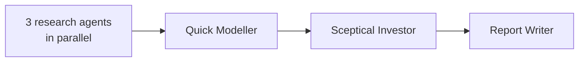
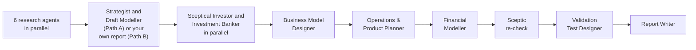

# Before You Build

An AI investment committee for founders. Get an honest verdict before you spend your savings.

Before You Build is for first-time and early founders who are deciding whether to quit a job, build, or raise money. You describe your idea, your region, your customers and your team. A group of AI agents researches the market, builds a simple financial model, argues against your idea like a sceptical investor, and gives you a verdict, the one assumption most likely to sink the business, and a cheap test you can run next.

**Status:** v0.1. This is an early version. Feedback is welcome: please open an issue.

## Install

You need:

- Claude Code, with web search allowed, because the agents research live on the web.
- Python 3.10 or later, which the scoring engine and the stage checker need.

On Windows, python3 may be called python or py.

In Claude Code, run these two commands:

```
/plugin marketplace add elakarborobhai21/before-you-build
/plugin install before-you-build@before-you-build
```

To start, ask Claude to "run Before You Build", or use the `before-you-build` skill. Claude will ask which mode you expect at the start, talk with you about your idea, and confirm the mode later.

## How it works

There are two modes.

- **Quick Check** is for screening an idea. It gives you a short decision pack.
- **Full Review** is for an idea you are seriously considering. It gives you a decision memo, a full plan, a financial model and a test plan.

### Quick Check



### Full Review



A Full Review has two paths:

- **Path A, no report yet:** the agents draft a strategy report and a first model for you.
- **Path B, bring your own report:** you upload a plan you already have, from a consultant, another AI tool or yourself. The agents skip the drafting step and test your report. They still do their own research, so the critics have independent evidence.

In the rebuild, the agents work one at a time: the Business Model Designer first, then the Operations & Product Planner from its rebuilt offer, then the Financial Modeller from both, taking the team and its costs from the operations plan. The plan and the model then describe the same business and the same team.

The agent that writes a plan never grades it. The critics do not see the drafter's working notes, and they recompute the numbers themselves.

### The Committee Scorecard

The verdict comes from the Committee Scorecard, which uses seven areas: customer pull, route to customers, money per transaction, cash to proof, competitive response, team and commitment, and rules and operations. Each area is rated Strong, Adequate, Weak or Fatal, and the ratings give a readiness score from 0 to 100.

The verdict is one of **Go to test**, **Pivot** or **Stop**. Some rules cap the verdict. For example, a Fatal area (an area that on its own can end the business) means the verdict cannot be better than Pivot. The best verdict is "Go to test". It means "run the cheap test", not "build the company".

Every test also includes a channel measure: the real cost to win a paying customer through the main channel in the plan, measured with real spend or outreach, with its own pass and fail lines. A product can pass its test and still fail on what it costs to reach customers, so the test checks both.

## What you get

Results are saved on your computer in `~/before-you-build-runs/<idea-slug>-<YYYY-MM-DD>/`.

Start with `50_decision/report.html`. Open it in any browser: it shows the verdict, the readiness score and the seven ratings as charts, the numbers with a switch between the three scenarios, the risks, and the test with its pass, fail and channel lines. In a Quick Check the numbers are charts for all three versions (Defensive, Moderate and Optimistic): cash over 24 months, profit or loss each month, and what one sale earns. Each version has a box for the conversion rate; type your own figure and every chart and number in that version is worked out again in the page. Every figure keeps its label, and each sourced label links to its source. The page is one file with no outside scripts or fonts, so it works offline and sends nothing anywhere. A script builds it from the run files, so it shows only what they say.

**Quick Check:**

- `00_brief.md`: your idea and details, as the agents understood them
- `10_research/`: research notes on market and competition, customer demand, and founder fit
- `20_model/quick_model.md`: a simple model with three scenarios (Defensive, Moderate, Optimistic)
- `20_model/model_inputs.json`: the same model as data, which the report uses to recalculate when you change the conversion rate
- `30_assessment/`: the Sceptical Investor's critique and the scorecard result
- `50_decision/report.html`: the report to open in a browser
- `50_decision/decision_pack.md`: the short decision pack
- `sources.md`: every link used

**Full Review:**

- `00_brief.md` and `sources.md`, as above
- `10_research/`: six research notes (market and region, competition, customer demand, regulation and structure, founder fit, funding climate)
- `20_draft/`: the strategy report and first model (Path A), or your uploaded report (Path B)
- `30_assessment/`: the Sceptical Investor and Investment Banker critiques, the scorecard result and the re-check
- `40_plan/`: business model, operations and product plan, financials and the rebuilt model
- `50_decision/`: `report.html` (the report to open in a browser), `decision_memo.md`, `full_plan.md`, `test_plan.md` and `gate_tracker.csv`

A Quick Check can be upgraded to a Full Review later.

## Example

[`examples/lagos-delivery-quick-check/`](examples/lagos-delivery-quick-check/) is a complete Quick Check of a fictional idea: a same-day parcel delivery service for small online sellers in Lagos. Start with the [decision pack](examples/lagos-delivery-quick-check/50_decision/decision_pack.md), or download [`report.html`](examples/lagos-delivery-quick-check/50_decision/report.html) and open it in a browser to see the HTML report. The founders are invented; the research is real and every link was checked when the example was made (October 2026). The verdict was Pivot, 48/100, confidence Medium.

## Evidence labels

Every number in a report carries a label:

- **[S] Sourced:** it comes from a source, and the link is given.
- **[E] Estimated:** the agent calculated it, and the method is given.
- **[A] Assumed:** the agent had no data, and the reason is given.

Numbers marked [E] or [A] are the first ones to check.

## Limits

- It uses public data only. It cannot see anything that is not public.
- Figures can be wrong, incomplete or out of date. Check the ones that matter.
- It is not financial, legal, tax or investment advice.
- It does not replace talking to real customers. The test it suggests is only a start.
- A Full Review uses many agents. It takes longer and uses more tokens (so costs more) than a Quick Check.
- v0.1 is built for Claude Code. A single-chat mode for ChatGPT and Claude.ai is planned, but it does not exist yet.

## Privacy

Results are saved only on your computer. Your idea is processed by Claude, and the agents may use parts of it in web searches, so do not include anything you must keep secret. The agents do not look up private information about people you name. They use only what you tell them and what is professionally public.

## Disclaimer

This report was produced by AI agents using publicly available information and the details you provided. Figures may be incomplete, out of date or wrong; each is marked sourced, estimated or assumed. It is not financial, legal, tax or investment advice. Check important figures yourself and talk to real customers before acting.

## Contributing

To run the tests, from the repository root:

```
python3 -m unittest discover -s tests -v
```

The tests use only the Python standard library. If you find a problem or have an idea, please open an issue. Notes for contributors and AI agents editing this repository are in [CLAUDE.md](CLAUDE.md).

## Acknowledgements

- Inspired in part by [idea-validation-agents](https://github.com/MaxKmet/idea-validation-agents) by Max Kmet (MIT). Before You Build uses its own scoring method and wording.
- Agent-collection format inspired by [The Agency (agency-agents)](https://github.com/msitarzewski/agency-agents) by msitarzewski and contributors (MIT).
- Built with Claude.

## Licence

MIT. See [LICENSE](LICENSE).
